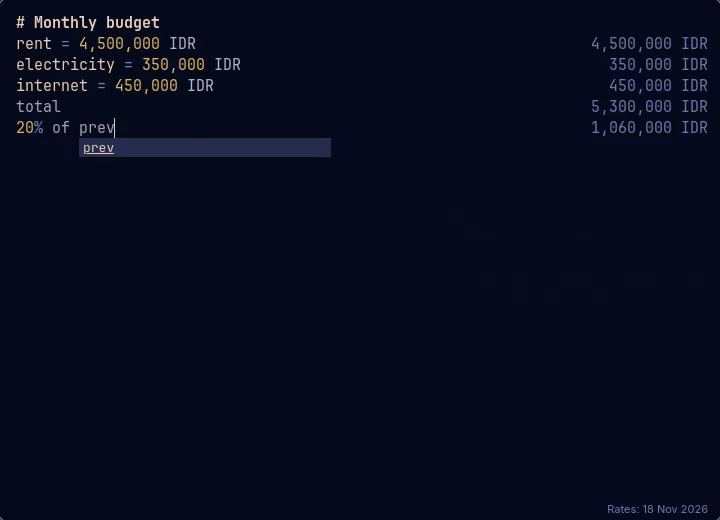
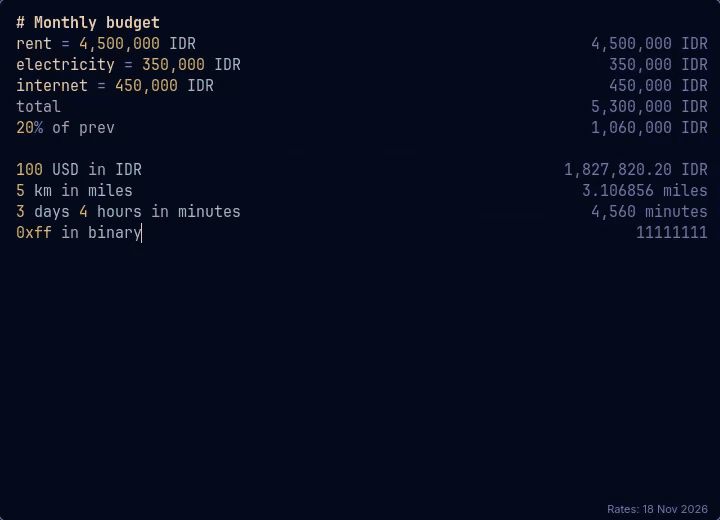

# notecal

A calculator notepad for Linux and macOS. Write natural math, one expression per line, and each line's result appears on the right as you type. Notes are plain text files.


## What it does

- Arithmetic with arbitrary precision (`0.1 + 0.2` is `0.3`), powers, `mod`, implicit multiplication
- Units and conversions with `in` / `to`: length, mass, volume, time, temperature, data size, speed, area
- Percentages the way you say them: `20% of 50`, `50 + 10%`, `5 as % of 20`
- Variables (`rent = 4,500,000`), `prev`, and block totals with `sum`, `total`, `avg`
- Currency conversion with daily rates, cached so it works offline
- Dates and time zones: `today + 2 weeks`, `2026-12-25 - today`, `now in Tokyo`, `3pm Jakarta in London`
- CSS units: `12 pt in px`, `2 rem in px`, with adjustable px per inch and em size
- Your own variables, functions and units for every note, in [`definitions.txt`](docs/linux-setup.md#definitions)
- Hex, binary and octal; `sqrt`, `round`, `log`, trig and more
- Thousands separators in input and output, in `en` (1,234.5) or `id` (1.234,5) format
- Several notes, saved automatically as `.txt` files; safe with Syncthing or git (it never overwrites a note that changed on disk while you were editing — your version goes to a conflict copy)
- Follows your Omarchy theme live, or use light, dark or your own palette

Conversions — currency, units, time and number bases:



Copy a result (it shows "Copied"), switch notes with Ctrl+P, and change the Omarchy theme while notecal follows it:



## Install

### Arch Linux

notecal isn't on the AUR yet, so build the package from this repository. It uses
the same PKGBUILD, and pacman installs, upgrades and removes it like any other
package:

```sh
git clone https://github.com/troazz/notecal
cd notecal/packaging/aur
makepkg -si
```

To upgrade later, run `git pull` in the clone, then `makepkg -si` again.

### Other Linux

Download the AppImage from [Releases](https://github.com/troazz/notecal/releases), make it executable and run it.

### macOS

```sh
brew install --cask troazz/tap/notecal
```

Or download the `.dmg` from [Releases](https://github.com/troazz/notecal/releases) and drag notecal to Applications. The app is not signed yet, so the first time, right-click it and choose **Open** (or run `xattr -d com.apple.quarantine /Applications/notecal.app`).

## Show and hide it with a key

On Wayland (Hyprland, Sway, GNOME) bind a key in your compositor to `notecal --toggle`. For Hyprland's Lua config (Omarchy):

```lua
hl.bind("ALT + SPACE", hl.dsp.exec_cmd("notecal --toggle"), { description = "notecal" })
```

On X11 and macOS, notecal registers Alt+Space itself (change it in Settings). More bindings and window rules: [docs/linux-setup.md](docs/linux-setup.md).

## Command line

`notecal-cli` evaluates from the terminal with your settings, definitions and cached rates:

```sh
notecal-cli 100 USD in IDR
notecal-cli --note budget
```

More, including an Omarchy menu entry and a Raycast script: [docs/linux-setup.md](docs/linux-setup.md#command-line).

## Keys

| Keys | Does |
|---|---|
| Ctrl+P | Find, create, rename (F2) or delete (Ctrl+Delete) a note |
| Ctrl+, | Settings |
| Esc | Hide the window |
| Click a result | Copy it as shown; Alt+click copies the bare number |
| Ctrl+Shift+C / Ctrl+Shift+B | Copy the current line's result / bare number |
| Ctrl+Shift+A | Read the current result aloud (screen readers) |
| Ctrl+Shift+T | Always on top (X11/macOS) |
| Tab | Accept an autocomplete suggestion |
| Ctrl+F | Search |

On macOS use Cmd instead of Ctrl.

## Files

| What | Linux | macOS |
|---|---|---|
| Notes | `~/.local/share/notecal/notes/` | `~/Library/Application Support/notecal/notes/` |
| Settings | `~/.config/notecal/settings.toml` | `~/Library/Application Support/notecal/settings.toml` |
| Your themes | `~/.config/notecal/themes/*.toml` | `~/Library/Application Support/notecal/themes/` |
| Rates cache | `~/.cache/notecal/rates.json` | `~/Library/Caches/notecal/rates.json` |

Settings are described in [docs/linux-setup.md](docs/linux-setup.md#settings). A theme file uses the same format as Omarchy's `colors.toml`, so any Omarchy theme can be copied in.

## Build from source

Needs Rust (stable), [bun](https://bun.sh), and on Linux the WebKitGTK 4.1 development package.

```sh
cd ui
bun install
bun run tauri build --no-bundle    # binary: target/release/notecal
```

Tests: `cargo test --workspace` and `cd ui && bun run test`.

## Credits

- Calculations by [fend](https://github.com/printfn/fend)
- Exchange rates by [Exchange Rate API](https://www.exchangerate-api.com) (open.er-api.com)
- Built with [Tauri](https://tauri.app), [Svelte](https://svelte.dev) and [CodeMirror](https://codemirror.net)

## License

MIT
